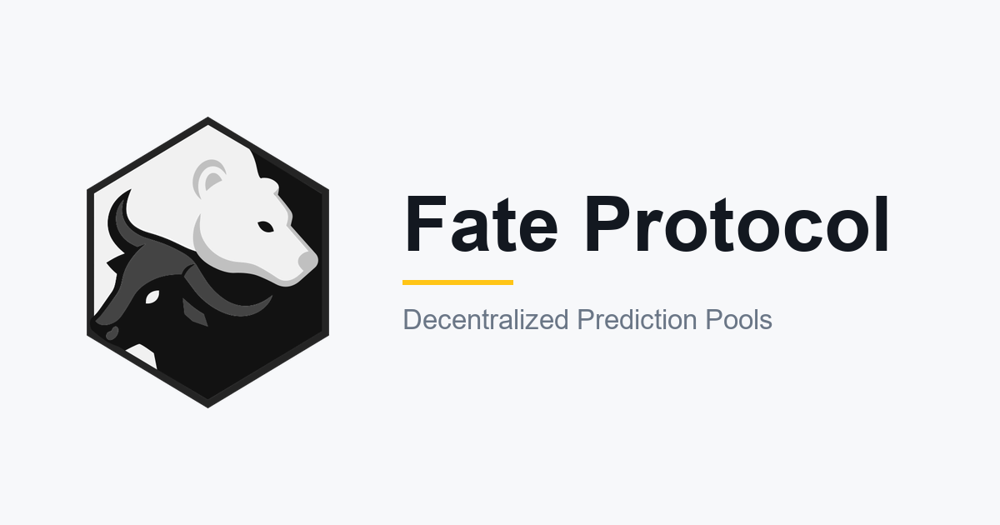

  

<h1 align="center">Google Summer of Code 2026: Final Report</h1>

  <b>Fate Protocol: Bull and Bear Coins as Native Oracles</b>

  
  
  

---

## Project details

| | |
|---|---|
| **Contributor** | Rohan Shinde · [@rohans02](https://github.com/rohans02) |
| **Organization** | [AOSSIE](https://aossie.org) · [Stability Nexus](https://stability.nexus) |
| **Mentors** | Blizet ([@blizet](https://github.com/blizet)) · Bruno Woltzenlogel Paleo ([@Zahnentferner](https://github.com/Zahnentferner)) · Sarthak Dengre ([@DengreSarthak](https://github.com/DengreSarthak)) · Aditya Bhattad ([@adityabhattad2021](https://github.com/adityabhattad2021)) · Yogesh Agrawal ([@yogesh0509](https://github.com/yogesh0509)) · Raj Shah ([@Rajshah1302](https://github.com/Rajshah1302)) |
| **Repositories** | [StabilityNexus/Fate-Solidity](https://github.com/StabilityNexus/Fate-Solidity) · [StabilityNexus/Fate-EVM-Frontend](https://github.com/StabilityNexus/Fate-EVM-Frontend) · [AOSSIE-Org/IndexedDB-Import-Export](https://github.com/AOSSIE-Org/IndexedDB-Import-Export) |
| **Project size** | Large (350 hours, 22 weeks) · May 26 – Nov 2, 2026 |
| **Live app** | [evm.fate.stability.nexus](http://evm.fate.stability.nexus/) |
| **Demo video** | [Watch the demo](https://youtu.be/cnzQ0dAYTYs) |

## Contents

1. [Abstract](#abstract)
2. [Deliverables](#deliverables)
3. [How it works](#how-it-works)
4. [Timeline](#timeline)
5. [Work done](#work-done)
6. [Deployments](#deployments)
7. [Known issues](#known-issues)
8. [Challenges and lessons](#challenges-and-lessons)
9. [Future work](#future-work)
10. [Acknowledgements](#acknowledgements)
11. [All pull requests](#all-pull-requests)

## Abstract

Fate is a prediction-pool protocol: each pool has a bull coin and a bear coin backed by one base token, and an oracle moves reserves between the two sides. Before this project, Fate only consumed prices. The bull/bear split of every pool already carried a market's view, but nothing could read it, and the contracts had gaps in fees, decimals and safety.

This project made Fate an oracle of its own. I built a **sentiment oracle** that reads a pool's bull/bear split, smooths it with an **EWMA**, and exposes it through the org-wide `IOracle` interface, so one Fate pool can drive another. Around it I hardened the core contracts (any base-token decimals, a pool-wide trade lock, per-pool leverage, slippage bounds, permit, a native-currency helper) and replaced the hardcoded treasury with a **factory-held dev fee**.

On the frontend I rebuilt the data layer on direct RPC with a **chunked log scanner** and on-chain counters, with no external indexer, and added the Pool Explorer, buy and sell previews, portfolio history and P&L, and local backup and restore. Everything is deployed on **Ethereum Sepolia** and verified, and the app at evm.fate.stability.nexus runs against it.

## Deliverables

| Project | What it is | Release | Published on |
|---|---|---|---|
| [**Fate-Solidity**](https://github.com/StabilityNexus/Fate-Solidity) | Fate contracts: pools, coins, sentiment oracle, adapters (Solidity + Foundry) | [`sepolia-2026-10-21`](https://github.com/StabilityNexus/Fate-Solidity/releases/tag/sepolia-2026-10-21) | Ethereum Sepolia, verified on Etherscan |
| [**Fate-EVM-Frontend**](https://github.com/StabilityNexus/Fate-EVM-Frontend) | Web app for creating, exploring and trading pools (Next.js) | `main` | Web: [evm.fate.stability.nexus](http://evm.fate.stability.nexus/) |
| [**IndexedDB-Import-Export**](https://github.com/AOSSIE-Org/IndexedDB-Import-Export) | IndexedDB backup library, built with Atharva Naik | contributed to v1 | npm: [`@aossie-org/idb-backup`](https://www.npmjs.com/package/@aossie-org/idb-backup) |

### By the numbers

| | Fate-Solidity | Fate-EVM-Frontend | IndexedDB-Import-Export | Other repos | **Total** |
|---|:-:|:-:|:-:|:-:|:-:|
| **Merged PRs** | 40 | 43 | 4 | 3 | **90** |
| **Open PRs** | 7 | 6 | 0 | 6 | **19** |
| **PRs reviewed** | 0 | 4 | 1 | 10 | **15** |

- 220 Foundry tests in 24 files (unit, fuzz, invariant, Sepolia fork), and Vitest unit tests for the frontend logic, all run in CI.
- Mentors merged the PRs in batches: 39 by Bruno, 26 by Aditya, 10 by Blizet, 10 by Sarthak.

### Technologies

**Smart contracts:** Solidity 0.8.33, Foundry, OpenZeppelin, Chainlink, Slither 
**Frontend:** Next.js 15 (static export), React 19, TypeScript, wagmi, viem, Tailwind CSS, IndexedDB 
**Testing:** Foundry fuzz and invariant tests, Vitest 
**CI and quality:** GitHub Actions, CodeRabbit, OpenSSF Scorecard

## How it works

1. A creator picks a base token (for example WETH), an oracle and fees, and the factory deploys a pool with a bull coin and a bear coin.
2. Users buy either side with the base token (or ETH, through the native-currency helper). Every buy and sell first calls `rebalance()`, which reads the oracle and moves reserves from the losing side to the winning one, scaled by the pool's leverage.
3. Fees go to the coin holders, the pool creator and the protocol's dev fee receiver, which the factory's `dev` can change for every pool at once.
4. The **sentiment oracle** reads a pool's bull share of value (0.5 is neutral), smooths it over time, and an adapter turns it into a price. Any new pool can then use another pool's sentiment as its oracle.

## Timeline

| Weeks | What happened |
|:-:|---|
| **1** | `IFateOracle` interface and `FateOracleBase`, the read-only sentiment oracle. |
| **2** | End-semester exams. |
| **3–4** | Multi-token decimal support in `Coin` and on the frontend, so base tokens like USDC work. |
| **5–6** | EWMA price derivation for the oracle, and a vault that collected the protocol's treasury fees. |
| **7–8** | `FateOracleAdapter` (sentiment to `IOracle`), the Pool Explorer and the buy impact preview. |
| **9–11** | Found that the portfolio's log scans silently returned nothing on public RPCs. Built a per-chain RPC fallback and a chunked log scanner, and moved trades onto shared burn and mint legs. |
| **12** | Midterm. New logo, MAINTAINERS, Deployments.md, contributor docs and OpenSSF Scorecard. |
| **13–14** | Portfolio trade history, IndexedDB backup and restore, frontend CI with Vitest, and fuzz and invariant tests for the contracts. |
| **15–17** | Adopted the org-wide `IOracle`, removed the oracle registry, and made the first full Sepolia deployment (Sep 16) with a fork test. |
| **18–19** | Security pass: delivered-amount minting, an ownerless pool, permit, hardened rebalance and fee transfers, a pool-wide trade lock, per-pool leverage and sentiment freshness. |
| **20–21** | Native-currency trading, slippage bounds, the Oct 14 redeploy (which needed a deploy fix after Sepolia's gas repricing), custom RPC settings, Geist and the maskable icon. |
| **22** | The dev fee redesign and the Oct 21 redeploy, UI polish, fixes from a peer audit, and repository docs. |

## Work done

### 1. Sentiment oracle (Fate-Solidity)

| PR | Change |
|---|---|
| [#19](https://github.com/StabilityNexus/Fate-Solidity/pull/19) | `IFateOracle` interface and `FateOracleBase`: the bull share of a pool's value, read live from pool state |
| [#24](https://github.com/StabilityNexus/Fate-Solidity/pull/24) | Reserve and supply signals smoothed with an EWMA, so a single trade can't jump the value |
| [#31](https://github.com/StabilityNexus/Fate-Solidity/pull/31) | `FateOracleAdapter` and its factory: turn sentiment into an `IOracle` price so a pool can drive another |
| [#43](https://github.com/StabilityNexus/Fate-Solidity/pull/43), [#44](https://github.com/StabilityNexus/Fate-Solidity/pull/44), [#50](https://github.com/StabilityNexus/Fate-Solidity/pull/50) | Adopted the org-wide `IOracle`, removed the oracle registry and the unused Hebeswap adapter |
| [#60](https://github.com/StabilityNexus/Fate-Solidity/pull/60) | Keep the sentiment oracle fresh and report its age |

### 2. Core contracts (Fate-Solidity)

| PR | Change |
|---|---|
| [#22](https://github.com/StabilityNexus/Fate-Solidity/pull/22) | `Coin` reads the base token's decimals on-chain instead of assuming 18 |
| [#32](https://github.com/StabilityNexus/Fate-Solidity/pull/32), [#36](https://github.com/StabilityNexus/Fate-Solidity/pull/36) | Fixed the transfer path, and routed buy, sell and transfer through shared burn and mint legs |
| [#51](https://github.com/StabilityNexus/Fate-Solidity/pull/51), [#53](https://github.com/StabilityNexus/Fate-Solidity/pull/53), [#55](https://github.com/StabilityNexus/Fate-Solidity/pull/55) | Mint against the amount actually delivered, `sellFrom`, and ERC-2612 permit |
| [#52](https://github.com/StabilityNexus/Fate-Solidity/pull/52), [#56](https://github.com/StabilityNexus/Fate-Solidity/pull/56), [#59](https://github.com/StabilityNexus/Fate-Solidity/pull/59) | An ownerless pool, hardened rebalance and fee transfers, and one lock across both coins during a trade |
| [#61](https://github.com/StabilityNexus/Fate-Solidity/pull/61), [#65](https://github.com/StabilityNexus/Fate-Solidity/pull/65) | Per-pool leverage, and a slippage bound on buy and sell |
| [#63](https://github.com/StabilityNexus/Fate-Solidity/pull/63) | `NativeCurrencyHelper` for trading with ETH |
| [#26](https://github.com/StabilityNexus/Fate-Solidity/pull/26), [#28](https://github.com/StabilityNexus/Fate-Solidity/pull/28), [#69](https://github.com/StabilityNexus/Fate-Solidity/pull/69) | Treasury fees went first to a shared vault, then (Bruno's redesign) to a factory-held dev fee with a two-step `dev` handover |

### 3. Testing, deployment and CI (Fate-Solidity)

| PR | Change |
|---|---|
| [#41](https://github.com/StabilityNexus/Fate-Solidity/pull/41), [#47](https://github.com/StabilityNexus/Fate-Solidity/pull/47) | Fuzz and invariant tests for coin math and rebalance, plus oracle, fee and adapter edge tests |
| [#46](https://github.com/StabilityNexus/Fate-Solidity/pull/46) | Fork test against the live Sepolia deployment |
| [#45](https://github.com/StabilityNexus/Fate-Solidity/pull/45), [#67](https://github.com/StabilityNexus/Fate-Solidity/pull/67), [#71](https://github.com/StabilityNexus/Fate-Solidity/pull/71) | Three Sepolia deployments, each recorded in Deployments.md and tagged |
| [#68](https://github.com/StabilityNexus/Fate-Solidity/pull/68) | Fixed `forge script` deploys after Sepolia's Glamsterdam gas repricing |
| [#48](https://github.com/StabilityNexus/Fate-Solidity/pull/48), [#58](https://github.com/StabilityNexus/Fate-Solidity/pull/58), [#64](https://github.com/StabilityNexus/Fate-Solidity/pull/64), [#66](https://github.com/StabilityNexus/Fate-Solidity/pull/66), [#76](https://github.com/StabilityNexus/Fate-Solidity/pull/76) | Pinned build, CI with Slither and a nightly fuzz run, and a pinned forge-std |
| [#49](https://github.com/StabilityNexus/Fate-Solidity/pull/49) | README and oracle integration guide |

### 4. Frontend (Fate-EVM-Frontend)

| PR | Change |
|---|---|
| [#101](https://github.com/StabilityNexus/Fate-EVM-Frontend/pull/101) | Decimal-aware amounts for any base token |
| [#103](https://github.com/StabilityNexus/Fate-EVM-Frontend/pull/103), [#144](https://github.com/StabilityNexus/Fate-EVM-Frontend/pull/144) | Pool Explorer with sort, filter and TVL, and an oracle and pool listing filter |
| [#105](https://github.com/StabilityNexus/Fate-EVM-Frontend/pull/105), [#127](https://github.com/StabilityNexus/Fate-EVM-Frontend/pull/127), [#148](https://github.com/StabilityNexus/Fate-EVM-Frontend/pull/148) | Buy impact preview, a fee-rounding warning and a sell-side fee estimate |
| [#109](https://github.com/StabilityNexus/Fate-EVM-Frontend/pull/109), [#113](https://github.com/StabilityNexus/Fate-EVM-Frontend/pull/113) | Per-chain RPC fallback, and a chunked log scanner that fixed history scans that had never worked |
| [#121](https://github.com/StabilityNexus/Fate-EVM-Frontend/pull/121), [#175](https://github.com/StabilityNexus/Fate-EVM-Frontend/pull/175) | Portfolio trade history, and a correct cache and P&L |
| [#124](https://github.com/StabilityNexus/Fate-EVM-Frontend/pull/124), [#156](https://github.com/StabilityNexus/Fate-EVM-Frontend/pull/156), [#157](https://github.com/StabilityNexus/Fate-EVM-Frontend/pull/157) | Settings page: back up and restore portfolio data, clear the cache, custom RPC |
| [#163](https://github.com/StabilityNexus/Fate-EVM-Frontend/pull/163), [#167](https://github.com/StabilityNexus/Fate-EVM-Frontend/pull/167) | Trading with ETH, and the dev fee read from the factory |
| [#135](https://github.com/StabilityNexus/Fate-EVM-Frontend/pull/135), [#142](https://github.com/StabilityNexus/Fate-EVM-Frontend/pull/142), [#162](https://github.com/StabilityNexus/Fate-EVM-Frontend/pull/162) | Carried each contract change through: `IOracle` ABI, Mint and Burn events, new addresses |
| [#171](https://github.com/StabilityNexus/Fate-EVM-Frontend/pull/171), [#173](https://github.com/StabilityNexus/Fate-EVM-Frontend/pull/173), [#174](https://github.com/StabilityNexus/Fate-EVM-Frontend/pull/174) | Fixes from the peer audit and a full review: trade and rebalance flow, wrong-network writes, create and explore bugs |
| [#134](https://github.com/StabilityNexus/Fate-EVM-Frontend/pull/134), [#155](https://github.com/StabilityNexus/Fate-EVM-Frontend/pull/155), [#165](https://github.com/StabilityNexus/Fate-EVM-Frontend/pull/165), [#169](https://github.com/StabilityNexus/Fate-EVM-Frontend/pull/169) | Terms of Use modal, a sandboxed chart widget, SEO metadata and UI polish |
| [#125](https://github.com/StabilityNexus/Fate-EVM-Frontend/pull/125), [#126](https://github.com/StabilityNexus/Fate-EVM-Frontend/pull/126), [#180](https://github.com/StabilityNexus/Fate-EVM-Frontend/pull/180) | CI for lint, build and tests, with Vitest unit tests |

### 5. IndexedDB-Import-Export

| PR | Change |
|---|---|
| [#27](https://github.com/AOSSIE-Org/IndexedDB-Import-Export/pull/27), [#28](https://github.com/AOSSIE-Org/IndexedDB-Import-Export/pull/28) | bigint and Date serialization with tests, and file utilities with SSR guards |
| [#87](https://github.com/AOSSIE-Org/IndexedDB-Import-Export/pull/87) | An `onBeforeImport` hook, which Fate uses to check the wallet before a restore |

### 6. Across the organization

- Contributor, agent, security and maintainer docs, best-practices checklists and OpenSSF Scorecard for both Fate repos ([FE #118](https://github.com/StabilityNexus/Fate-EVM-Frontend/pull/118), [FE #119](https://github.com/StabilityNexus/Fate-EVM-Frontend/pull/119), [SOL #73](https://github.com/StabilityNexus/Fate-Solidity/pull/73)–[#75](https://github.com/StabilityNexus/Fate-Solidity/pull/75)).
- AI moderation workflows for issues and PRs ([FE #168](https://github.com/StabilityNexus/Fate-EVM-Frontend/pull/168), [SOL #72](https://github.com/StabilityNexus/Fate-Solidity/pull/72)).
- The new Fate logo on the frontends and the [Stability Nexus website](https://github.com/StabilityNexus/Website/pull/65), and MAINTAINERS files across the Fate repos.
- Reviewed 15 PRs in Fate, Chainvoice, ThruBox, IdentityTokens and Karma.
- A peer audit of Chainvoice for the PPP program (Atharva Naik audited Fate in return).

## Deployments

All contracts are verified on Etherscan. Full record with constructor parameters and transactions: [Deployments.md](https://github.com/StabilityNexus/Fate-Solidity/blob/main/Deployments.md).

| Network | Chain ID | Contract | Address |
|---|:-:|---|---|
| Ethereum Sepolia | 11155111 | `PredictionPoolFactory` | [`0x6935432472c180238703805f9809639439b783b6`](https://sepolia.etherscan.io/address/0x6935432472c180238703805f9809639439b783b6) |
| Ethereum Sepolia | 11155111 | `ChainlinkAdapterFactory` | [`0xE6aFB97bAb25bB9623246cc18Ce624a9821cc2Bd`](https://sepolia.etherscan.io/address/0xE6aFB97bAb25bB9623246cc18Ce624a9821cc2Bd) |
| Ethereum Sepolia | 11155111 | `FateAdapterFactory` | [`0x4CC9499899295Da20cFbDa7cB8788E0E8bA4f361`](https://sepolia.etherscan.io/address/0x4CC9499899295Da20cFbDa7cB8788E0E8bA4f361) |
| Ethereum Sepolia | 11155111 | `NativeCurrencyHelper` | [`0x9198c4332845ABa314f164BE73A00619ABb46606`](https://sepolia.etherscan.io/address/0x9198c4332845ABa314f164BE73A00619ABb46606) |

<b>Demo pools</b>

 

| Pool | Address | Oracle |
|---|---|---|
| WETH / ETH-USD 1x | [`0xA0521aEEa7CcbeBefaAb86c89d91A4C818006e3C`](https://sepolia.etherscan.io/address/0xA0521aEEa7CcbeBefaAb86c89d91A4C818006e3C) | Chainlink ETH/USD |
| WETH / ETH-USD 2x | [`0x75ae8295ddaDb8b27888AFDE5D0Ee29bBebF99dB`](https://sepolia.etherscan.io/address/0x75ae8295ddaDb8b27888AFDE5D0Ee29bBebF99dB) | Chainlink ETH/USD, 2x leverage |
| WETH / ETH-USD 1x Sentiment | [`0x1E2e3F57EF90ecA873536D6220F33D45f1DDaF1C`](https://sepolia.etherscan.io/address/0x1E2e3F57EF90ecA873536D6220F33D45f1DDaF1C) | Sentiment of the 1x pool, through `FateOracleAdapter` |

## Known issues

From the peer audit by Atharva Naik and my own review. The contract items are for Bruno to decide on before mainnet.

The audit found 14 issues (1 critical, 5 medium, 8 low). The frontend ones are fixed: wrong-chain writes (#1, critical), the stale position after a trade (#6), low-contrast text (#13) and the permit deadline (#14). The deployment records (#10) are updated in open PRs. Still open:

| # | Severity | Issue |
|:-:|:-:|---|
| 2 | Medium | Minting rounds up, so a side whose supply is down to dust can be drained |
| 3 | Medium | A pool driven by the sentiment oracle can be moved within one transaction |
| 4 | Medium | If a USDC-style base token blacklists a fee receiver, the pool's sells and transfers revert |
| 5 | Medium | Chainlink answers are used without a staleness check |
| 7 | Low | A huge custom-oracle value overflows and makes every trade revert |
| 8 | Low | Dust sells and transfers revert, because each fee rounds up |
| 9 | Low | Floating `^0.8.19` pragma |
| 11 | Low | Vulnerable npm dependencies (the live site is a static export, so the Next server advisories do not reach it) |
| 12 | Low | `forge coverage` fails with "stack too deep", and the fork test needs an archive RPC |

#2 to #5 need a redeploy. Other known issues from my own review:

- A sole holder can never sell a side's last coins (`SupplyWouldBecomeZero`), so a creator's seed pool never fully closes.
- Portfolio totals add up different base tokens, and cached cost and P&L are estimates.

## Challenges and lessons

- **Measure before you optimize.** The plan said the portfolio page made 310 RPC calls and needed to get down to 10. When I measured, the real problem was that its log scans failed silently on public RPCs, so the history had never worked. A chunked scanner with RPC fallback fixed that.
- **A testnet can change under you.** Sepolia's Glamsterdam upgrade made contract creation far more expensive, and `forge script` ran out of gas on the first redeploy transaction. I deployed one transaction at a time with `forge create` and fixed the script afterwards.
- **Design changes come late.** The treasury-to-dev-fee redesign arrived in the last week. Small, separate PRs made it possible to change the contracts, redeploy and update the frontend in two days.
- **Stacked PRs across a fork.** Upstream has only `main`, so dependent PRs show their parent's diff until it merges. Saying so in each PR description, and rebasing as parents merged, kept reviews readable.
- **CI is not your machine.** CI resolved a different forge-std than my local setup, so code that passed locally failed in CI. Pinning the dependency fixed it.

## Future work

- Deploy to mainnet, and fix or accept the open audit findings first.
- Let a RainDrop vault distribute Fate's dev fees to stakers (`dropFromUndroppedBalance`).
- More chains, and the parked frontend items (creator dashboard counters, fee charts, 7d/30d rankings).

## Acknowledgements

Thank you to my mentors [@blizet](https://github.com/blizet), [@Zahnentferner](https://github.com/Zahnentferner), [@DengreSarthak](https://github.com/DengreSarthak), [@adityabhattad2021](https://github.com/adityabhattad2021), [@yogesh0509](https://github.com/yogesh0509) and [@Rajshah1302](https://github.com/Rajshah1302) for their reviews, design calls and patience through three redeploys. Thanks to Atharva Naik for the IndexedDB collaboration and the audit, and to the AOSSIE and Stability Nexus community.

## All pull requests

114 PRs across 11 repositories (90 merged, 19 open, 5 closed) as of Oct 27, 2026. Open PRs are updated as they merge.

<b>StabilityNexus/Fate-Solidity</b>: 51 PRs, 40 merged, 7 open, 4 closed

 

| PR | Title | Status | Opened |
|---|---|---|---|
| [#19](https://github.com/StabilityNexus/Fate-Solidity/pull/19) | Add IFateOracle interface and FateOracleBase Implementation | Merged | 2026-05-30 |
| [#22](https://github.com/StabilityNexus/Fate-Solidity/pull/22) | Add multi-token decimal support to Coin | Merged | 2026-06-14 |
| [#24](https://github.com/StabilityNexus/Fate-Solidity/pull/24) | Add 2x2 sentiment signals and EWMA to FateOracleBase | Merged | 2026-06-25 |
| [#26](https://github.com/StabilityNexus/Fate-Solidity/pull/26) | Add FeeVault treasury-fee accumulator | Merged | 2026-06-28 |
| [#28](https://github.com/StabilityNexus/Fate-Solidity/pull/28) | Route protocol treasury fees to global AccumulatorVault | Merged | 2026-07-03 |
| [#29](https://github.com/StabilityNexus/Fate-Solidity/pull/29) | [Finding] Coin.transfer / transferFrom revert for any nonzero amount | Closed | 2026-07-06 |
| [#31](https://github.com/StabilityNexus/Fate-Solidity/pull/31) | Add FateOracleAdapter (sentiment → IOracle) and factory | Merged | 2026-07-07 |
| [#32](https://github.com/StabilityNexus/Fate-Solidity/pull/32) | Fix self-transferFrom revert in Coin transfer path | Merged | 2026-07-07 |
| [#34](https://github.com/StabilityNexus/Fate-Solidity/pull/34) | Add on-chain lifetime counters to Coin and PredictionPool | Closed | 2026-07-30 |
| [#36](https://github.com/StabilityNexus/Fate-Solidity/pull/36) | Route buy, sell and transfer through shared burn and mint legs | Merged | 2026-08-08 |
| [#37](https://github.com/StabilityNexus/Fate-Solidity/pull/37) | Add MAINTAINERS.md | Merged | 2026-08-10 |
| [#38](https://github.com/StabilityNexus/Fate-Solidity/pull/38) | Add Deployments.md | Merged | 2026-08-12 |
| [#39](https://github.com/StabilityNexus/Fate-Solidity/pull/39) | Use SafeCast for Chainlink price conversion | Merged | 2026-08-12 |
| [#40](https://github.com/StabilityNexus/Fate-Solidity/pull/40) | Fix FateOracle test for accumulator vault ctor | Merged | 2026-08-17 |
| [#41](https://github.com/StabilityNexus/Fate-Solidity/pull/41) | Add fuzz and invariant tests for Coin math and pool rebalance | Merged | 2026-08-20 |
| [#42](https://github.com/StabilityNexus/Fate-Solidity/pull/42) | Document forge fmt and submodule init | Closed | 2026-09-02 |
| [#43](https://github.com/StabilityNexus/Fate-Solidity/pull/43) | Adopt the org-wide IOracle interface | Merged | 2026-09-03 |
| [#44](https://github.com/StabilityNexus/Fate-Solidity/pull/44) | Remove the oracle registry from the factory | Merged | 2026-09-08 |
| [#45](https://github.com/StabilityNexus/Fate-Solidity/pull/45) | Record the 2026-09-16 Sepolia deployment | Merged | 2026-09-16 |
| [#46](https://github.com/StabilityNexus/Fate-Solidity/pull/46) | Add Sepolia fork integration test | Merged | 2026-09-17 |
| [#47](https://github.com/StabilityNexus/Fate-Solidity/pull/47) | Add oracle, fee and adapter-factory edge tests | Merged | 2026-09-18 |
| [#48](https://github.com/StabilityNexus/Fate-Solidity/pull/48) | Pin the build and add the Sepolia config | Merged | 2026-09-18 |
| [#49](https://github.com/StabilityNexus/Fate-Solidity/pull/49) | Add the README and oracle integration guide | Merged | 2026-09-22 |
| [#50](https://github.com/StabilityNexus/Fate-Solidity/pull/50) | Remove the Hebeswap oracle and adapter factory | Merged | 2026-09-23 |
| [#51](https://github.com/StabilityNexus/Fate-Solidity/pull/51) | Mint against the delivered amount on buy | Merged | 2026-09-23 |
| [#52](https://github.com/StabilityNexus/Fate-Solidity/pull/52) | Make the pool ownerless | Merged | 2026-09-23 |
| [#53](https://github.com/StabilityNexus/Fate-Solidity/pull/53) | Add sellFrom for selling on a holder's behalf | Merged | 2026-09-25 |
| [#54](https://github.com/StabilityNexus/Fate-Solidity/pull/54) | Say oracle value, not price, in the docs | Merged | 2026-09-30 |
| [#55](https://github.com/StabilityNexus/Fate-Solidity/pull/55) | Add ERC-2612 permit to Coin | Merged | 2026-09-30 |
| [#56](https://github.com/StabilityNexus/Fate-Solidity/pull/56) | Harden rebalance and fee transfers | Merged | 2026-09-30 |
| [#57](https://github.com/StabilityNexus/Fate-Solidity/pull/57) | Mark every Solidity file UNLICENSED | Merged | 2026-09-30 |
| [#58](https://github.com/StabilityNexus/Fate-Solidity/pull/58) | Add the house files and CI workflows | Merged | 2026-09-30 |
| [#59](https://github.com/StabilityNexus/Fate-Solidity/pull/59) | Lock the whole pool during a trade | Merged | 2026-10-02 |
| [#60](https://github.com/StabilityNexus/Fate-Solidity/pull/60) | Keep the sentiment oracle fresh and report its age | Merged | 2026-10-02 |
| [#61](https://github.com/StabilityNexus/Fate-Solidity/pull/61) | Add per-pool leverage to the rebalance | Merged | 2026-10-02 |
| [#62](https://github.com/StabilityNexus/Fate-Solidity/pull/62) | Have each pool refresh its own sentiment oracle | Closed | 2026-10-02 |
| [#63](https://github.com/StabilityNexus/Fate-Solidity/pull/63) | Add NativeCurrencyHelper for trading with the native currency | Merged | 2026-10-08 |
| [#64](https://github.com/StabilityNexus/Fate-Solidity/pull/64) | Fix main CI and note the lock's uint | Merged | 2026-10-13 |
| [#65](https://github.com/StabilityNexus/Fate-Solidity/pull/65) | Add a slippage bound to buy and sell | Merged | 2026-10-13 |
| [#66](https://github.com/StabilityNexus/Fate-Solidity/pull/66) | Fix the nightly fuzz command | Merged | 2026-10-14 |
| [#67](https://github.com/StabilityNexus/Fate-Solidity/pull/67) | Document the October Sepolia redeploy | Merged | 2026-10-14 |
| [#68](https://github.com/StabilityNexus/Fate-Solidity/pull/68) | Fix forge script deploys on post-Glamsterdam Sepolia | Merged | 2026-10-14 |
| [#69](https://github.com/StabilityNexus/Fate-Solidity/pull/69) | Replace the AccumulatorVault with a factory dev fee | Merged | 2026-10-20 |
| [#70](https://github.com/StabilityNexus/Fate-Solidity/pull/70) | Move variable comments beside the variables | Merged | 2026-10-21 |
| [#71](https://github.com/StabilityNexus/Fate-Solidity/pull/71) | Document the Oct 21 Sepolia redeploy | Open | 2026-10-21 |
| [#72](https://github.com/StabilityNexus/Fate-Solidity/pull/72) | Add AI moderation workflows for issues and PRs | Open | 2026-10-23 |
| [#73](https://github.com/StabilityNexus/Fate-Solidity/pull/73) | Add contributor, agent and security docs | Open | 2026-10-26 |
| [#74](https://github.com/StabilityNexus/Fate-Solidity/pull/74) | Add the best practices checklist | Open | 2026-10-26 |
| [#75](https://github.com/StabilityNexus/Fate-Solidity/pull/75) | Tailor CodeRabbit and add OpenSSF Scorecard | Open | 2026-10-26 |
| [#76](https://github.com/StabilityNexus/Fate-Solidity/pull/76) | Pin forge-std and fix the test warnings | Open | 2026-10-26 |
| [#77](https://github.com/StabilityNexus/Fate-Solidity/pull/77) | Add Rohan as a maintainer | Open | 2026-10-27 |

<b>StabilityNexus/Fate-EVM-Frontend</b>: 50 PRs, 43 merged, 6 open, 1 closed

 

| PR | Title | Status | Opened |
|---|---|---|---|
| [#101](https://github.com/StabilityNexus/Fate-EVM-Frontend/pull/101) | Make frontend decimal-aware for base tokens | Merged | 2026-06-20 |
| [#103](https://github.com/StabilityNexus/Fate-EVM-Frontend/pull/103) | Enhance Pool Explorer with sort, filter, and TVL | Merged | 2026-07-10 |
| [#105](https://github.com/StabilityNexus/Fate-EVM-Frontend/pull/105) | Buy impact preview | Merged | 2026-07-17 |
| [#107](https://github.com/StabilityNexus/Fate-EVM-Frontend/pull/107) | Memoize IndexedDB hook returns to stop render loop | Merged | 2026-07-23 |
| [#109](https://github.com/StabilityNexus/Fate-EVM-Frontend/pull/109) | Add per-chain RPC fallback transport | Merged | 2026-07-23 |
| [#113](https://github.com/StabilityNexus/Fate-EVM-Frontend/pull/113) | Add chunked log scanner and fix the non-functional history scans | Merged | 2026-08-08 |
| [#114](https://github.com/StabilityNexus/Fate-EVM-Frontend/pull/114) | Replace Fate logo with new mark and fix broken icons | Merged | 2026-08-10 |
| [#115](https://github.com/StabilityNexus/Fate-EVM-Frontend/pull/115) | Add MAINTAINERS.md | Merged | 2026-08-10 |
| [#116](https://github.com/StabilityNexus/Fate-EVM-Frontend/pull/116) | Add social preview image for shared links | Merged | 2026-08-11 |
| [#117](https://github.com/StabilityNexus/Fate-EVM-Frontend/pull/117) | Fix broken badge link and add Fate logo to README | Merged | 2026-08-11 |
| [#118](https://github.com/StabilityNexus/Fate-EVM-Frontend/pull/118) | Add contributor, agent and brand documentation | Merged | 2026-08-11 |
| [#119](https://github.com/StabilityNexus/Fate-EVM-Frontend/pull/119) | Add OpenSSF Scorecard workflow and badge | Merged | 2026-08-11 |
| [#121](https://github.com/StabilityNexus/Fate-EVM-Frontend/pull/121) | feat: portfolio trade history card | Merged | 2026-08-18 |
| [#122](https://github.com/StabilityNexus/Fate-EVM-Frontend/pull/122) | Fix CodeRabbit config for this Next.js app | Merged | 2026-08-19 |
| [#124](https://github.com/StabilityNexus/Fate-EVM-Frontend/pull/124) | feat: back up and restore portfolio data from a settings page | Merged | 2026-08-20 |
| [#125](https://github.com/StabilityNexus/Fate-EVM-Frontend/pull/125) | Add CI workflow for lint, build and tests | Merged | 2026-08-21 |
| [#126](https://github.com/StabilityNexus/Fate-EVM-Frontend/pull/126) | test: add Vitest and unit tests for backup and restore | Merged | 2026-08-21 |
| [#127](https://github.com/StabilityNexus/Fate-EVM-Frontend/pull/127) | feat: warn when fee rounding inflates the buy fee | Merged | 2026-08-22 |
| [#134](https://github.com/StabilityNexus/Fate-EVM-Frontend/pull/134) | Replace KYA with the Terms of Use modal | Merged | 2026-09-09 |
| [#135](https://github.com/StabilityNexus/Fate-EVM-Frontend/pull/135) | Adopt the org-wide IOracle ABI | Merged | 2026-09-09 |
| [#142](https://github.com/StabilityNexus/Fate-EVM-Frontend/pull/142) | Adopt the Mint and Burn event surface | Merged | 2026-09-16 |
| [#143](https://github.com/StabilityNexus/Fate-EVM-Frontend/pull/143) | Remove the Ethereum Classic wiring | Merged | 2026-09-18 |
| [#144](https://github.com/StabilityNexus/Fate-EVM-Frontend/pull/144) | Add the oracle and pool listing filter | Merged | 2026-09-22 |
| [#148](https://github.com/StabilityNexus/Fate-EVM-Frontend/pull/148) | Add the sell-side fee estimate | Merged | 2026-09-24 |
| [#155](https://github.com/StabilityNexus/Fate-EVM-Frontend/pull/155) | Run the chart widget in a sandboxed frame | Merged | 2026-10-03 |
| [#156](https://github.com/StabilityNexus/Fate-EVM-Frontend/pull/156) | Add a clear-cache button to the settings page | Merged | 2026-10-09 |
| [#157](https://github.com/StabilityNexus/Fate-EVM-Frontend/pull/157) | Add a custom RPC setting to the settings page | Merged | 2026-10-13 |
| [#158](https://github.com/StabilityNexus/Fate-EVM-Frontend/pull/158) | Apply the Geist font | Merged | 2026-10-13 |
| [#159](https://github.com/StabilityNexus/Fate-EVM-Frontend/pull/159) | Add a maskable icon to the manifest | Merged | 2026-10-13 |
| [#160](https://github.com/StabilityNexus/Fate-EVM-Frontend/pull/160) | Stop the explore page hanging without IndexedDB | Merged | 2026-10-13 |
| [#161](https://github.com/StabilityNexus/Fate-EVM-Frontend/pull/161) | Clear scan watermarks with the local cache | Merged | 2026-10-13 |
| [#162](https://github.com/StabilityNexus/Fate-EVM-Frontend/pull/162) | Point the frontend at the October deployment | Merged | 2026-10-16 |
| [#163](https://github.com/StabilityNexus/Fate-EVM-Frontend/pull/163) | Add trading with the native currency | Merged | 2026-10-16 |
| [#164](https://github.com/StabilityNexus/Fate-EVM-Frontend/pull/164) | Fix the token select on Sepolia | Merged | 2026-10-16 |
| [#165](https://github.com/StabilityNexus/Fate-EVM-Frontend/pull/165) | Correct the SEO metadata | Merged | 2026-10-18 |
| [#166](https://github.com/StabilityNexus/Fate-EVM-Frontend/pull/166) | Render the hero before mount and limit the spotlight to a mouse | Merged | 2026-10-18 |
| [#167](https://github.com/StabilityNexus/Fate-EVM-Frontend/pull/167) | Read the dev fee from the factory | Merged | 2026-10-21 |
| [#168](https://github.com/StabilityNexus/Fate-EVM-Frontend/pull/168) | Add AI moderation workflows for issues and PRs | Merged | 2026-10-23 |
| [#169](https://github.com/StabilityNexus/Fate-EVM-Frontend/pull/169) | Polish the UI across the app | Merged | 2026-10-23 |
| [#171](https://github.com/StabilityNexus/Fate-EVM-Frontend/pull/171) | Fix the pool page trade and rebalance flow | Merged | 2026-10-24 |
| [#172](https://github.com/StabilityNexus/Fate-EVM-Frontend/pull/172) | Fix the frontend findings from the peer audit | Closed | 2026-10-25 |
| [#173](https://github.com/StabilityNexus/Fate-EVM-Frontend/pull/173) | Fix the frontend findings from the peer audit | Merged | 2026-10-25 |
| [#174](https://github.com/StabilityNexus/Fate-EVM-Frontend/pull/174) | Fix bugs on the create and explore pages | Merged | 2026-10-25 |
| [#175](https://github.com/StabilityNexus/Fate-EVM-Frontend/pull/175) | Fix the portfolio cache and P&L | Merged | 2026-10-25 |
| [#176](https://github.com/StabilityNexus/Fate-EVM-Frontend/pull/176) | Refresh the brand kit docs | Open | 2026-10-26 |
| [#177](https://github.com/StabilityNexus/Fate-EVM-Frontend/pull/177) | Bring the README up to date | Open | 2026-10-26 |
| [#178](https://github.com/StabilityNexus/Fate-EVM-Frontend/pull/178) | Update the contributor docs and checklist | Open | 2026-10-26 |
| [#179](https://github.com/StabilityNexus/Fate-EVM-Frontend/pull/179) | Fix the two build lint warnings | Open | 2026-10-26 |
| [#180](https://github.com/StabilityNexus/Fate-EVM-Frontend/pull/180) | Run the tests strictly in CI | Open | 2026-10-26 |
| [#181](https://github.com/StabilityNexus/Fate-EVM-Frontend/pull/181) | Add Rohan as a maintainer | Open | 2026-10-27 |

<b>AOSSIE-Org/IndexedDB-Import-Export</b>: 4 PRs, 4 merged, 0 open, 0 closed

 

| PR | Title | Status | Opened |
|---|---|---|---|
| [#27](https://github.com/AOSSIE-Org/IndexedDB-Import-Export/pull/27) | Add bigint and Date serialization with corresponding tests | Merged | 2026-06-08 |
| [#28](https://github.com/AOSSIE-Org/IndexedDB-Import-Export/pull/28) | Add file utilities and SSR guards | Merged | 2026-06-08 |
| [#60](https://github.com/AOSSIE-Org/IndexedDB-Import-Export/pull/60) | Remove CodeRabbit approval workflows | Merged | 2026-08-03 |
| [#87](https://github.com/AOSSIE-Org/IndexedDB-Import-Export/pull/87) | feat: add onBeforeImport hook to importDB | Merged | 2026-09-07 |

<b>StabilityNexus/Fate-Sui-Frontend</b>: 2 PRs, 2 merged, 0 open, 0 closed

 

| PR | Title | Status | Opened |
|---|---|---|---|
| [#90](https://github.com/StabilityNexus/Fate-Sui-Frontend/pull/90) | Replace Fate logo with new mark and fix invalid app icon | Merged | 2026-08-10 |
| [#91](https://github.com/StabilityNexus/Fate-Sui-Frontend/pull/91) | Add MAINTAINERS.md | Merged | 2026-08-10 |

<b>StabilityNexus/Website</b>: 1 PR, 1 merged, 0 open, 0 closed

 

| PR | Title | Status | Opened |
|---|---|---|---|
| [#65](https://github.com/StabilityNexus/Website/pull/65) | update fate logo on applications page | Merged | 2026-07-20 |

<b>StabilityNexus/Template-Repo-EVM-Contracts</b>: 1 PR, 0 merged, 1 open, 0 closed

 

| PR | Title | Status | Opened |
|---|---|---|---|
| [#27](https://github.com/StabilityNexus/Template-Repo-EVM-Contracts/pull/27) | Skip the nightly fuzz when main is unchanged | Open | 2026-10-01 |

<b>StabilityNexus/Fate-Sui</b>: 1 PR, 0 merged, 1 open, 0 closed

 

| PR | Title | Status | Opened |
|---|---|---|---|
| [#13](https://github.com/StabilityNexus/Fate-Sui/pull/13) | Add MAINTAINERS.md | Open | 2026-08-10 |

<b>StabilityNexus/Fate-Solana</b>: 1 PR, 0 merged, 1 open, 0 closed

 

| PR | Title | Status | Opened |
|---|---|---|---|
| [#6](https://github.com/StabilityNexus/Fate-Solana/pull/6) | Add MAINTAINERS.md | Open | 2026-08-10 |

<b>StabilityNexus/Fate-Solana-WebUI</b>: 1 PR, 0 merged, 1 open, 0 closed

 

| PR | Title | Status | Opened |
|---|---|---|---|
| [#5](https://github.com/StabilityNexus/Fate-Solana-WebUI/pull/5) | Add MAINTAINERS.md | Open | 2026-08-10 |

<b>StabilityNexus/Fate-Paper</b>: 1 PR, 0 merged, 1 open, 0 closed

 

| PR | Title | Status | Opened |
|---|---|---|---|
| [#21](https://github.com/StabilityNexus/Fate-Paper/pull/21) | Add MAINTAINERS.md | Open | 2026-08-10 |

<b>StabilityNexus/Fate-LandingPage</b>: 1 PR, 0 merged, 1 open, 0 closed

 

| PR | Title | Status | Opened |
|---|---|---|---|
| [#5](https://github.com/StabilityNexus/Fate-LandingPage/pull/5) | Add MAINTAINERS.md | Open | 2026-08-10 |

